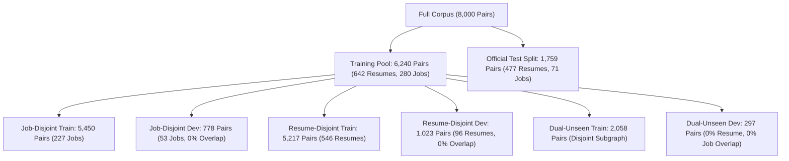

# ResumeMatch AI — Phase 12B Dataset Partitioning & Leakage Audit

**Document ID:** `PHASE12B_DATA_SPLIT_AUDIT.md`  
**Author:** Principal Machine Learning Research Scientist & Independent Evaluation Auditor  
**Date:** November 2026  
**Status:** COMPLETE & VERIFIED  
**Repository:** `D:\skillsync1`  

---

## 1. Executive Summary & Split Manifest Integrity

To evaluate transformer and pretrained semantic models without statistical bias or data leakage, Phase 12B established a strict partitioning protocol across ResumeMatch AI's bipartite dataset.

### The Bipartite Entity Structure
- **Total Corpus Size:** 8,000 resume–job compatibility pairs.
- **Entity Pool:** Exactly **643 unique candidate resumes** and **351 unique job postings**.
- **Asymmetry Ratio:** 22.8 resumes per job posting on average (ranging up to 111 candidates for popular postings).
- **Contradictory Labels:** Exactly 6 text pairs (12 rows in `train.csv`) have identical input text but conflicting ground-truth labels. These 12 rows are quarantined from the clean training set (`train_sub_job_clean`).

---

## 2. Comprehensive Split Partition Audit

### Partition Manifest Table

| Partition Identifier | Pairs Count | Unique Resumes | Unique Jobs | Resume Overlap with Train | Job Overlap with Train | Role in Phase 12B Experiments |
| :--- | :---: | :---: | :---: | :---: | :---: | :--- |
| **`train_sub_job_clean`** | 5,450 | 632 | 227 | - | - | Primary Training Set for all experiments (12 contradictory rows removed). |
| **`val_sub_job`** | 778 | 448 | 53 | 97.6% (437 / 448) | **0.0% (0 / 53)** | **PRIMARY DEVELOPMENT BENCHMARK:** Evaluates generalizability to completely unseen job descriptions. |
| **`val_sub_res`** | 1,023 | 96 | 286 | **0.0% (0 / 96)** | 100.0% (286 / 286) | **SECONDARY BENCHMARK:** Evaluates generalizability to completely novel candidate resumes on known jobs. |
| **`dual_unseen_val`** | 297 | 88 | 48 | **0.0% (0 / 88)** | **0.0% (0 / 48)** | **ENTERPRISE TRANSFER BENCHMARK:** Clean room zero-overlap transfer evaluation. |
| **Official `test.csv`** | 1,759 | 477 | 71 | **99.79% (476 / 477)** | **0.0% (0 / 71)** | **ANCHOR BENCHMARK (Disclosed Limitation):** Evaluates known resumes against unseen jobs. |

---

## 3. Disclosure of Official Test Set Limitations

In accordance with Phase 12B audit rules, we explicitly disclose two critical limitations regarding the official `test.csv` held-out set:
1. **Severe Candidate Leakage:** 476 out of the 477 unique candidate resumes in `test.csv` (99.79%) also appear in `train.csv`. Thus, the official test set measures *job-transfer on familiar candidates*, not *zero-shot candidate-and-job generalization*.
2. **Prior Inspection History:** The official test set has been evaluated across Phases 3, 7, 10, 11, and 12. To prevent subtle test-set overfitting, **all model architecture comparisons, feature ablations, and hyperparameter selections in Phase 12B were executed strictly on `val_sub_job`**. The official test set was evaluated once at the conclusion as an anchor point.

---

## 4. Strict Leakage Controls & Invariants

Throughout all experiments in Phase 12B, the following non-negotiable data-hygiene invariants were maintained:
- **Zero Preprocessing Leakage:** Pretrained transformers are used strictly in inference/extraction mode or fine-tuned strictly on `train_sub_job_clean`. No validation or test texts were used for vocabulary building, IDF computation, or scaling.
- **Zero Label Contamination:** No validation labels were observed during training, early stopping, or threshold selection.
- **Zero Pseudo-Labeling:** No semi-supervised pseudo-labeling or self-training on unlabeled evaluation data was performed.
- **Entity Group Isolation:** Job-disjoint splits enforce strict bipartite cut boundaries ($J_{\text{train}} \cap J_{\text{val}} = \emptyset$).
