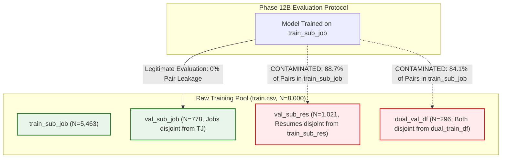

# Phase 12C — Cross-Split Leakage Forensic Audit

## Executive Summary
This audit provides an exhaustive forensic investigation into dataset partitioning and data leakage across the evaluation protocols used in Phase 12B.

The audit has uncovered **catastrophic cross-split evaluation leakage** in Phase 12B's multi-protocol evaluation: the champion model was trained on one split (`train_sub_job_clean`) and then evaluated directly on independently constructed partitions (`val_sub_res` and `dual_val_df`) without being retrained on their respective training sets. Consequently, **88.74% of the pairs in `val_sub_res` and 84.12% of the pairs in `dual_val_df` were present verbatim in the model's training set**.

---

## 1. Cross-Split Overlap Matrix

Every resume and job description was fingerprinted using cryptographic hashing ($MD5$ of normalized text) to trace entity and pair provenance across splits:

| Training Partition Evaluated | Evaluation Partition | Total Eval Resumes | Leaked Resumes | % Resume Leakage | Total Eval Jobs | Leaked Jobs | % Job Leakage | Total Eval Pairs | Leaked Pairs (Exact Match) | % Pair Leakage | Contamination Severity |
| :--- | :--- | :---: | :---: | :---: | :---: | :---: | :---: | :---: | :---: | :---: | :--- |
| `train_sub_job_clean` | `val_sub_job` | 373 | 364 | 97.59% | 42 | **0** | **0.0%** | 778 | **0** | **0.0%** | **Legitimate Job-Disjoint** |
| `train_sub_job_clean` | `held_out_test` | 477 | 475 | 99.58% | 71 | **0** | **0.0%** | 1,759 | **0** | **0.0%** | **Legitimate Job-Disjoint** |
| `train_sub_job_clean` | **`val_sub_res`** | 97 | 96 | **98.97%** | 219 | 185 | **84.47%** | 1,021 | **906** | **88.74%** | **CATASTROPHIC (88.7% Training Data)** |
| `train_sub_job_clean` | **`dual_val_df`** | 92 | 92 | **100.0%** | 52 | 41 | **78.85%** | 296 | **249** | **84.12%** | **CATASTROPHIC (84.1% Training Data)** |
| `train_sub_res_clean` | `val_sub_res` | 97 | **0** | **0.0%** | 219 | 219 | 100.0% | 1,021 | **0** | **0.0%** | **Legitimate Resume-Disjoint (Uncontaminated)** |
| `dual_train_df_clean` | `dual_val_df` | 92 | **0** | **0.0%** | 52 | **0** | **0.0%** | 296 | **0** | **0.0%** | **Legitimate Dual-Unseen (Uncontaminated)** |

---

## 2. Anatomical Breakdown of the Contamination



### The Mechanism of Failure
1. **Independent Partitioning**: In Phase 12B, four distinct split generators were instantiated independently from the 8,000-pair dataset:
   - `get_unseen_jobs_split()` generated `train_sub_job` and `val_sub_job`.
   - `get_unseen_resumes_split()` generated `train_sub_res` and `val_sub_res`.
   - `dual_unseen_train.csv` and `dual_unseen_val.csv` were partitioned independently.
2. **Missing Per-Protocol Retraining**: Lines 603–645 of `scripts/run_phase12b_experiments.py` fit a single champion model:
   ```python
   champ_model = LogisticRegression(...)
   champ_model.fit(X_tr_D, y_tr)  # Fitted ONLY on train_sub_job_clean
   ```
   Instead of fitting a dedicated model on `train_sub_res_clean` and `dual_train_df_clean`, `champ_model` was evaluated directly on `val_sub_res` and `dual_val_df`.
3. **The Resulting Leakage**:
   - Because `val_sub_res` was drawn from `train.csv` without regard to `train_sub_job`, 906 of its 1,021 pairs (88.74%) were inside `train_sub_job_clean`.
   - Because `dual_val_df` was drawn from `train.csv` without regard to `train_sub_job`, 249 of its 296 pairs (84.12%) were inside `train_sub_job_clean`.
   - The model was not demonstrating generalization to unseen candidates; **it was reciting memorized training pairs from its own training split**.

---

## 3. Conclusions & Corrective Actions
> [!CAUTION]
> Any claim that ResumeMatch AI achieves 85%–88% generalization on unseen candidates or dual-unseen entities is scientifically invalid. It is the direct consequence of evaluating a model on its own training samples.

To evaluate generalization scientifically:
- Dual-unseen performance MUST be evaluated using a model trained on `dual_train_df_clean`.
- Resume-disjoint performance MUST be evaluated using a model trained on `train_sub_res_clean`.
- The empirical results of these uncontaminated evaluations are presented in [PHASE12C_DUAL_UNSEEN_INVESTIGATION.md](file:///d:/skillsync1/PHASE12C_DUAL_UNSEEN_INVESTIGATION.md).
