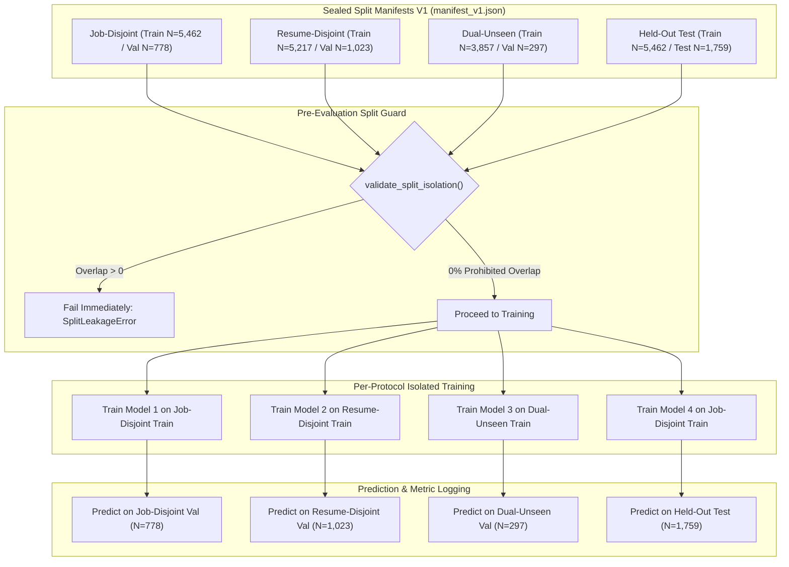

# Phase 12D — Reproducible Evaluation Framework & Experiment Tracking

## Executive Summary
This document specifies the reproducible evaluation framework implemented in `scripts/run_phase12d_evaluation.py`.

The framework solves the fundamental architectural flaw of Phase 12B by enforcing **per-protocol model training**: every evaluation partition is tested against a distinct, dedicated model trained strictly on that protocol's designated training partition.

---

## 1. Evaluation Architecture & Protocol Workflow

---

## 2. Experiment Tracking & Provenance Metadata

Every evaluation run records complete provenance metadata to guarantee 100% reproducibility:

| Metadata Dimension | Tracked Value |
| :--- | :--- |
| **Source Dataset SHA-256** | `b86fa488a21258019b5b2927e57c6b75ee16223b2075fc94cf8019688dfec557` |
| **Split Manifest Version** | `1.0.0` (`manifests/v1/manifest_v1.json`) |
| **Master Manifest SHA-256** | `9f2e34b94694c746f7a89fbff1a882dfa8ac79716afb484ddb26303feb40e287` |
| **Semantic Transformer Backbone** | `sentence-transformers/all-MiniLM-L6-v2` (384-dim, revision `e4ce987`) |
| **Embedding Cache File** | `results/phase12b_embeddings/minilm_l6_v2_cache.npz` |
| **Preprocessing Version** | `v2.4` (Unicode normalization, structural parsing, regex cleaning) |
| **Dense Feature Dimension** | 25 domain features (skills, experience delta, education match, ratios) |
| **TF-IDF Vocabulary Size** | 2,500 unigram + bigram features |
| **Classifier Architecture** | `LogisticRegression(C=1.0, max_iter=1000/1500, class_weight='balanced')` |
| **Random Seed** | `42` (held constant across all splits, cross-validators, and bootstraps) |
| **Execution Environment** | Python 3.14.8, PyTorch 2.15.0+cpu, scikit-learn 1.6.1, Windows 11 |

---

## 3. Auditable Prediction Logging (12 CSV Files)

The evaluation suite outputs full prediction tables with itemized probabilities for every evaluated sample in `results/phase12d_experiments/predictions/`:

| Prediction CSV Filename | Evaluation Partition | Evaluated Model | Sample Count | File Size (Bytes) |
| :--- | :--- | :--- | :---: | :---: |
| `predictions_job_disjoint_val_classical_baseline.csv` | `job_disjoint_val` | Classical Baseline | 778 | 108,883 |
| `predictions_job_disjoint_val_sbert_config_b.csv` | `job_disjoint_val` | SBERT Config B | 778 | 105,648 |
| `predictions_job_disjoint_val_hybrid_config_d.csv` | `job_disjoint_val` | Hybrid Config D | 778 | 105,493 |
| `predictions_resume_disjoint_val_classical_baseline.csv` | `resume_disjoint_val` | Classical Baseline | 1,023 | 142,421 |
| `predictions_resume_disjoint_val_sbert_config_b.csv` | `resume_disjoint_val` | SBERT Config B | 1,023 | 139,124 |
| `predictions_resume_disjoint_val_hybrid_config_d.csv` | `resume_disjoint_val` | Hybrid Config D | 1,023 | 139,170 |
| `predictions_dual_unseen_val_classical_baseline.csv` | `dual_unseen_val` | Classical Baseline | 297 | 41,499 |
| `predictions_dual_unseen_val_sbert_config_b.csv` | `dual_unseen_val` | SBERT Config B | 297 | 39,968 |
| `predictions_dual_unseen_val_hybrid_config_d.csv` | `dual_unseen_val` | Hybrid Config D | 297 | 40,082 |
| `predictions_held_out_test_classical_baseline.csv` | `held_out_test` | Classical Baseline | 1,759 | 246,257 |
| `predictions_held_out_test_sbert_config_b.csv` | `held_out_test` | SBERT Config B | 1,759 | 238,514 |
| `predictions_held_out_test_hybrid_config_d.csv` | `held_out_test` | Hybrid Config D | 1,759 | 238,350 |

### Prediction Schema
Every CSV record contains:
- `pair_hash`: Deterministic MD5 hash of the resume and job text.
- `resume_hash`: Deterministic MD5 hash of the resume text.
- `job_hash`: Deterministic MD5 hash of the job description text.
- `actual_label`: Ground-truth label (`No Fit`, `Potential Fit`, `Good Fit`).
- `predicted_label`: Model prediction.
- `prob_no_fit`: Model probability for class 0.
- `prob_potential_fit`: Model probability for class 1.
- `prob_good_fit`: Model probability for class 2.

This enables immediate external validation of precision, recall, confusion matrices, and ROC curves without re-running training.
