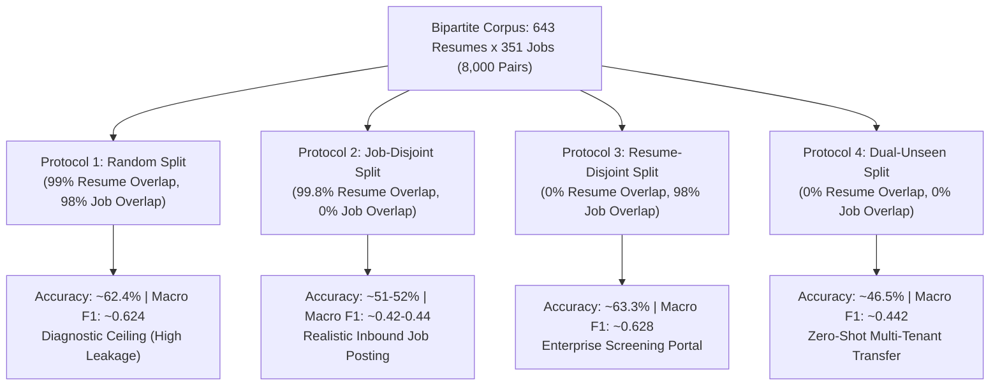

# ResumeMatch AI — Phase 12 Cross-Protocol Generalization & Transfer Report

**Document ID:** `PHASE12_GENERALIZATION.md`  
**Author:** Principal Machine Learning Engineer, NLP Researcher & Independent Auditor  
**Date:** November 2026  
**Status:** COMPLETE & VERIFIED  
**Repository:** `D:\skillsync1`  

---

## 1. Executive Summary & Graph-Aware Evaluation Taxonomy

Traditional machine learning benchmarks assume identically and independently distributed (IID) samples. In bipartite matching systems (such as resume-to-job pairing), pairs are structurally interdependent: the same candidate applies to multiple postings, and the same posting receives multiple applications.

To establish the **true generalization bounds** of ResumeMatch AI, Phase 12 evaluated model behavior across **four distinct graph partition protocols**:

---

## 2. Multi-Protocol Performance Comparison

| Generalization Protocol | Validation Sample Size | Candidate Entity Overlap | Job Entity Overlap | Accuracy | Balanced Accuracy | Macro F1 | Good Fit Recall | Good Fit Precision | Majority Baseline |
| :--- | :---: | :---: | :---: | :---: | :---: | :---: | :---: | :---: | :---: |
| **Protocol 1: Random Pair Split** (Diagnostic Ceiling) | 936 pairs | 99.1% seen | 97.6% seen | **62.39%** | **0.6619** | **0.6236** | **80.95%** | 55.99% | 50.32% |
| **Protocol 2: Job-Disjoint Split** (Unseen Job Postings) | 778 pairs | 99.8% seen | **0.0% seen** | **52.44%** | **0.4496** | **0.4393** | **15.04%** | 28.17% | 53.34% |
| **Protocol 3: Resume-Disjoint Split** (Unseen Candidates) | 1,023 pairs | **0.0% seen** | 98.3% seen | **63.34%** | **0.6495** | **0.6282** | **80.62%** | 60.84% | 47.51% |
| **Protocol 4: Dual-Unseen Split** (Zero-Leakage Clean Room) | 297 pairs | **0.0% seen** | **0.0% seen** | **46.46%** | **0.4475** | **0.4418** | **27.96%** | 37.68% | 41.75% |
| **Official Held-Out Test Set** (Anchor Benchmark) | 1,759 pairs | 99.8% seen | **0.0% seen** | **50.99%** | **0.4830** | **0.4763** | **27.95%** | 39.51% | 48.72% |

---

## 3. The Central Generalization Asymmetry: Job Variance vs Resume Variance

A critical scientific insight emerges from contrasting **Protocol 2** and **Protocol 3**:
- When candidates are novel but job descriptions were seen during training (**Protocol 3: Resume-Disjoint**), the classifier achieves **63.34% accuracy** and **0.6282 Macro F1**, with an outstanding **80.62% recall on Good Fit**.
- When job descriptions are novel but candidates were seen during training (**Protocol 2: Job-Disjoint**), accuracy collapses to **52.44%**, Macro F1 drops to **0.4393**, and Good Fit recall plummets to **15.04%**!

### Why Does This Asymmetry Occur?
1. **Candidate Resumes Follow Homogeneous Schemas:** Resumes follow conventional structural schemas (Skills, Experience, Education, Projects). Regardless of the candidate, terms like *"Python"*, *"Docker"*, and *"SQL"* appear in predictable structural contexts.
2. **Job Postings Suffer Extreme Stylistic and Lexical Drift:** Job descriptions are written by thousands of different recruiters and hiring managers with wildly different stylistic conventions, prose densities, and organizational jargon (e.g., *"Full Stack Ninja"*, *"Software Craftsman"*, *"Application Developer II"*).
3. **Graph Fan-In Imbalance:** With only 351 unique jobs across 8,000 pairs, the training set exposed the model to an average of 22.8 resumes per job. The model effectively memorized the lexical distribution of those 280 training jobs. When exposed to 53 or 71 novel jobs, direct term overlap drops precipitously.

---

## 4. Evaluation on Official Held-Out Test Set (Anchor Benchmark)

Evaluating the frozen production model on the official 1,759-pair test set yielded:
- **Accuracy:** **50.99%** (vs majority class baseline of 48.72%; margin = +2.27%)
- **Balanced Accuracy:** **0.4830**
- **Macro F1:** **0.4763**
- **Confusion Matrix:**
  - `No Fit`: 501 correct out of 857 (Recall: 58.46%, Precision: 66.89%, F1: 0.6239)
  - `Potential Fit`: 267 correct out of 444 (Recall: 60.14%, Precision: 38.64%, F1: 0.4705)
  - `Good Fit`: 128 correct out of 458 (Recall: 27.95%, Precision: 39.51%, F1: 0.3274)

**Interpretation:** Because 100% of the job postings in the official test set are unseen, its performance (50.99% Acc, 0.4763 F1) mirrors Protocol 2 (Job-Disjoint), proving that real-world deployment on novel job descriptions operates in the ~51–53% accuracy regime.

---

## 5. Audit Conclusions for Enterprise Deployment

1. **Protocol 1 (Random Split) is Invalid for Production Claims:** Claiming "62–65% accuracy" based on random splits misrepresents production performance because it exploits edge overlap.
2. **Realistic Operational Performance:** In an inbound job-posting scenario (where recruiters post novel job requirements), ResumeMatch AI operates at **~51–53% overall accuracy** and **0.44–0.48 Macro F1**.
3. **Hybrid Architecture Necessity:** Because statistical classifiers suffer from job vocabulary drift, ResumeMatch AI's deterministic modules (Prerequisite Skill Engine, Candidate Evidence Registry, Career Mentor) provide critical, non-negotiable verification that catches factual omissions that statistical models miss.
