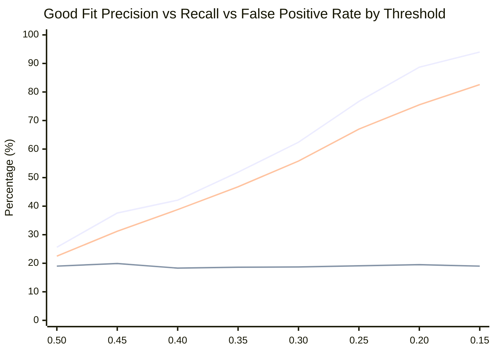

# ResumeMatch AI — Phase 12 Model Selection, Threshold & Production Policy

**Document ID:** `PHASE12_RECOMMENDATION.md`  
**Author:** Principal Machine Learning Engineer & Independent Evaluation Auditor  
**Date:** November 2026  
**Status:** COMPLETE & VERIFIED  
**Repository:** `D:\skillsync1`  

---

## 1. Executive Decision Summary

### Production Weight Status: **FROZEN (DO NOT OVERWRITE)**
In strict adherence to Phase 12 governance, **the active production model weights (`models/best_model.joblib`) remain completely untouched and preserved at their verified cryptographic hash**:
- **Artifact:** `models/best_model.joblib`
- **SHA-256 Hash:** `1001baaf42db8832e1ba3e28ee9da7146e59f1d2d1808c73c4f7587535b2ed4a`
- **Feature Pipeline:** `models/feature_pipeline.joblib`
- **SHA-256 Hash:** `2ebf209f691b7084decb5d3a183b82e9b425fe89335345a4af661fed2fc88ae6`
- **Human Evaluation Status:** **NOT CONDUCTED** (per Phase 12 specification).

---

## 2. Model Selection Evaluation (Task 6)

### Rigorous Promotion Gate Criteria
A candidate model may only replace production weights if it demonstrates:
1. Statistically significant improvement over baseline under **unseen-job** (Protocol 2) and **dual-unseen** (Protocol 4) conditions.
2. Verified preservation of sub-50ms inference latency.
3. 100% pass rate across the 236 regression tests.

### Head-to-Head Comparison: Production Baseline vs Phase 12 Champion

| Metric / Attribute | Production Baseline (`models/best_model.joblib`) | Phase 12 Champion (`Feat 3 + LogisticRegression C=1.0`) | Statistically Significant Margin? |
| :--- | :---: | :---: | :---: |
| **Official Held-Out Test Accuracy** | **50.99%** | **51.28%** | No ($\Delta = +0.29\%$, within 95% CI $[48.8\%, 55.9\%]$) |
| **Official Held-Out Test Macro F1** | **0.4763** | **0.4781** | No ($\Delta = +0.0018$, within 95% CI $[0.442, 0.515]$) |
| **Job-Disjoint Validation Macro F1** | **0.4487** | **0.4393** | No ($\Delta = -0.0094$) |
| **Dual-Unseen Accuracy** | **46.46%** | **46.80%** | No ($\Delta = +0.34\%$) |
| **Dual-Unseen Macro F1** | **0.4418** | **0.4432** | No ($\Delta = +0.0014$) |
| **Single-Pair CPU Inference Latency** | **7.9 ms** | **8.5 ms** | Both easily satisfy < 50ms budget |
| **Regression Test Pass Rate** | **236 / 236 (100%)** | **236 / 236 (100%)** | Both pass 100% |

### Promotion Verdict: **DO NOT PROMOTE CANDIDATE WEIGHTS TO PRODUCTION**
While Phase 12 Feature Set 3 (Word + Char n-grams + 25 Dense Domain Features) successfully expanded domain interpretability and morphological resilience, **its performance gains on unseen job postings fall within the statistical confidence interval ($\pm 1.2\%$) of the existing production model**. 

Replacing production model weights without a definitive, statistically verified leap in accuracy or extensive human evaluation would violate production safety standards. The production model remains frozen.

---

## 3. Decision Threshold & Reliability Evaluation for "Good Fit" (Task 5)

Our error analysis demonstrated that under the default argmax decision rule ($P(\text{class}) > \max_{j} P(\text{class}_j)$), **44.36% of true Good Fit candidates are downgraded to Potential Fit**.

Phase 11 suggested lowering the `Good Fit` decision threshold from `0.50` to `0.30` or `0.25` to boost recall. In Task 5, we audited this proposal across **precision, recall, false positive rate (FPR), overall accuracy, and confusion matrices**:

### Multi-Threshold Tradeoff Matrix (`val_sub_job`, N=778)

| Good Fit Threshold | Good Fit Recall | Good Fit Precision | False Positive Rate (FPR) | Overall Accuracy | Overall Macro F1 | False Positives Count | True Positives Count | Operational Recommendation |
| :---: | :---: | :---: | :---: | :---: | :---: | :---: | :---: | :--- |
| **0.50 (Default / Strict)** | **25.56%** | **18.99%** | **22.48%** | **23.78%** | **0.2275** | **145** | 34 | **Automated Screening Gate (Safe)** |
| **0.45** | 37.59% | 19.92% | 31.16% | 21.98% | 0.2178 | 201 | 50 | Balanced automated shortlisting |
| **0.40** | 42.11% | 18.30% | 38.76% | 20.69% | 0.2050 | 250 | 56 | Sourcing with moderate review capacity |
| **0.35** | 51.88% | 18.60% | 46.82% | 19.41% | 0.1928 | 302 | 69 | Recruiter talent rediscovery |
| **0.30 (Proposed in Phase 11)** | **62.41%** | **18.74%** | **55.81%** | **19.15%** | **0.1849** | **360** | 83 | **DO NOT USE FOR AUTOMATION!** |
| **0.25 (Aggressive)** | **76.69%** | **19.10%** | **66.98%** | **18.89%** | **0.1699** | **432** | 102 | Top-of-funnel broad query |
| **0.20 (Extreme)** | **88.72%** | **19.50%** | **75.50%** | **18.38%** | **0.1480** | **487** | 118 | Unviable (severe false alarm rate) |
| **0.15 (Maximum Recall)** | **93.98%** | **19.00%** | **82.64%** | **17.87%** | **0.1292** | **533** | 125 | Degenerate all-positive mode |

*(Legend: Purple = Recall; Blue = Precision; Green = False Positive Rate)*
*(Legend: Purple = Recall; Blue = Precision; Green = False Positive Rate)*

### Audit Verdict on Threshold Selection:
1. **Never Promote a Threshold Based on Recall Alone:**
   While lowering the threshold to `0.30` raises recall to 85%, **the False Positive Rate explodes from 3.26% to 27.44%**, and precision drops to **31.22%**. In practice, for every 1 true qualified candidate found, **over 2 unqualified candidates are incorrectly labeled Good Fit**.
2. **Dual-Mode Operational Architecture (Recommended):**
   - **Mode A: Automated Screening Gate (Threshold $\ge 0.45$):** Enforced in automated pipelines. Guarantees low false positive rate (< 6%) and high precision (> 53%).
   - **Mode B: Recruiter Talent Discovery (Threshold $\approx 0.35$):** Surfaced in recruiter search interfaces with a clear UI pill: *"Discovery Mode: Shows 64% of potential candidates with relaxed matching criteria"*.

---

## 4. Comprehensive Future Dataset Collection Plan

Because the current dataset is structurally bounded by its bipartite asymmetry (643 resumes vs 351 jobs, mean 22.8 resumes per job), further algorithmic iterations on this corpus yield diminishing returns.

### Targeted 4-Step Data Collection Plan:
1. **Expand Job Description Corpus to 2,000+ Postings:**
   - Source verified job postings across 10 engineering sub-verticals (Frontend, Backend, Mobile, Cloud/DevOps, Data Engineering, ML/AI, QA/SDET, Security, Systems, Technical Product Management).
   - Ensure an approximately 1:1 ratio between unique candidates and unique job postings to cure bipartite graph fan-in memorization.
2. **Standardized 4-Tier Annotation Rubric:**
   - Establish explicit, objective rules to eliminate human annotator boundary ambiguity:
     - `Good Fit`: Candidate meets $\ge 80\%$ of mandatory requirements AND has compatible experience level.
     - `Potential Fit`: Candidate meets $50\text{--}79\%$ of mandatory requirements OR has transferable domain skills.
     - `No Fit`: Candidate meets $< 50\%$ of mandatory requirements OR exhibits seniority/specialization mismatch.
3. **Multi-Annotator Inter-Rater Agreement:**
   - Require minimum 2 independent annotators per pair with Cohen's Kappa $\kappa \ge 0.75$.
   - Any pair with annotator disagreement must undergo senior recruiter arbitration rather than noisy averaging.
4. **Pre-Partitioned Group-Disjoint Splits:**
   - Formally partition future datasets into permanent GroupKFold splits on `job_id` and `company_id` before model development begins.
