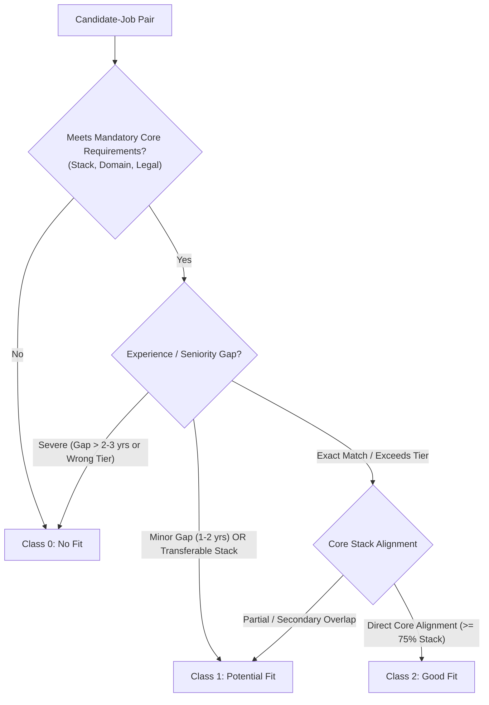

# ResumeMatch AI — Phase 12I: Professional Recruiter Annotation Rubric

**Document ID:** `PHASE12I_ANNOTATION_RUBRIC`  
**Classification:** Research Governance, Recruiter Annotation Protocol & Quality Framework  
**Target Benchmark:** ResumeMatch Independent Benchmark (IB-2850)  
**Standard:** Dual Independent Human Annotation with Cohen's $\kappa_w \ge 0.70$ Quality Gate  

---

## 1. Principles of Evaluation

Annotators must act as senior technical recruiters evaluating whether a candidate profile warrants advancing to a technical hiring screen for a specific job posting.

### Fundamental Evaluation Rules:
1. **Model-Blind:** Annotators must NEVER see model predictions, feature scores, or third-party automated match labels.
2. **Independent Review:** Annotator A and Annotator B evaluate candidate pairs independently in parallel without communication.
3. **Evidence-Based:** Ratings must be grounded strictly in explicit or clearly transferable qualifications present in the resume text. Do not invent missing facts or penalize candidates for formatting artifacts.
4. **Distinction between Hard Requirements and Nice-to-Haves:**
   - *Mandatory Requirements:* Minimum years of relevant experience, core programming language/domain stack, legal/work authorization constraints (if specified).
   - *Transferable Skills:* Closely related frameworks (e.g. Django $\leftrightarrow$ Flask/FastAPI, React $\leftrightarrow$ Vue, AWS $\leftrightarrow$ GCP, Postgres $\leftrightarrow$ MySQL).
   - *Preferred / Desirable Skills:* Bonus qualifications that enhance fit but do not disqualify a candidate.

---

## 2. Three-Class Fit Definition & Granular Rubric

### Class 0: No Fit
* **Definition:** The candidate lacks the fundamental qualifications, domain experience, or technical stack required for the role, and the gaps cannot be reasonably bridged within a standard 30–60 day onboarding period.
* **Exemplary Scenarios:**
  - *Domain Disconnect:* A front-end web developer applying for an embedded C/firmware robotics engineering role.
  - *Severe Experience Gap:* An entry-level boot-camp graduate (0–1 years) applying for a Principal / Staff Distributed Systems Architect role requiring 10+ years.
  - *Core Stack Absence:* A pure Java/Spring developer applying for an iOS role requiring deep Swift/Objective-C experience without mobile exposure.
  - *Unmet Mandatory Gate:* Role requires specialized domain licensing or specific language fluency not demonstrated by the candidate.

### Class 1: Potential Fit
* **Definition:** The candidate demonstrates strong foundational technical capabilities, adjacent or transferable skill sets, and acceptable experience level, but possesses minor addressable skill gaps or requires ramp-up in secondary frameworks.
* **Exemplary Scenarios:**
  - *Transferable Stack:* A senior backend engineer with 6 years of Python/Django and PostgreSQL applying for a Go/PostgreSQL backend role.
  - *Minor Experience Shortfall:* Candidate has 3.5 years of relevant React/TypeScript experience applying for a role requesting 5+ years, but demonstrated exceptional project ownership and complexity.
  - *Cross-Cloud Portability:* Candidate has deep production expertise in AWS applying for a GCP-focused role.
  - *Domain Transition:* An enterprise software engineer applying for a fintech or e-commerce role where business domain knowledge must be acquired on the job.

### Class 2: Good Fit
* **Definition:** The candidate directly satisfies or exceeds all core technical competencies, required experience years, domain requirements, and primary stack specifications. The candidate would be advanced to hiring manager interview immediately.
* **Exemplary Scenarios:**
  - *Direct Stack & Tier Match:* A Senior React/Node.js developer with 6 years of experience applying for a Senior Full-Stack React/Node role (5+ years req).
  - *Exact Domain Alignment:* A Data Engineer with extensive PySpark, dbt, Snowflake, and Airflow experience applying for a Data Platform role specifying that exact stack.
  - *Exceeds Baseline:* Mid-level role where candidate brings exact core skills plus valuable production expertise in CI/CD and system architecture.

---

## 3. Disagreement Resolution & Adjudication Protocol

### Quality Metrics & Acceptance Gate
For every batch of annotated pairs:
1. **Unweighted Cohen's $\kappa$:** Measures exact agreement adjusted for chance.
2. **Quadratic-Weighted Cohen's $\kappa_w$:** Penalizes distant errors (No Fit vs Good Fit) much more heavily than adjacent errors (No Fit vs Potential Fit).
   $$\kappa_w = 1 - \frac{\sum_{i,j} w_{ij} O_{ij}}{\sum_{i,j} w_{ij} E_{ij}}, \quad w_{ij} = \frac{(i - j)^2}{(k - 1)^2}$$
3. **Per-Class Agreement ($F_1$-Agreement):** Measures concordance on minority classes (specifically Good Fit).
4. **Quality Gate:** **$\kappa_w \ge 0.70$**. If $\kappa_w < 0.70$, the batch is rejected, the rubric is calibrated, and annotators are re-trained before re-evaluating.

### Disagreement Resolution Table
| Annotator A | Annotator B | Severity | Adjudication Action |
| :---: | :---: | :---: | :--- |
| **No Fit** | **Potential Fit** | Minor (Adjacent) | Adjudicator reviews candidate transferable skills and experience depth; decides based on rubric guidelines. |
| **Potential Fit** | **Good Fit** | Minor (Adjacent) | Adjudicator reviews mandatory vs nice-to-have job criteria; decides whether ramp-up is needed. |
| **No Fit** | **Good Fit** | **Severe (Polar Disagreement)** | **Mandatory Deep Review**. Both annotators provide written justification citing specific resume lines. Senior Lead Recruiter conducts final binding adjudication. |

---

## 4. Annotator Guidelines & Operational Workflow

1. **Step 1 — Read Job Description First:** Identify top 3 mandatory requirements, acceptable alternative technologies, and required seniority tier.
2. **Step 2 — Scan Candidate Summary & Recent Positions:** Verify total relevant career years and recent technological focus (last 3–5 years carry 80% weight).
3. **Step 3 — Check Skill Mentions in Project Context:** Prefer demonstrated application in production over raw keyword lists.
4. **Step 4 — Assign Independent Label:** Record `0` (No Fit), `1` (Potential Fit), or `2` (Good Fit), along with a 1-sentence evidence rationale.
5. **Step 5 — Submission:** Submit batch via blinded CSV template without comparing notes with peer annotators.
