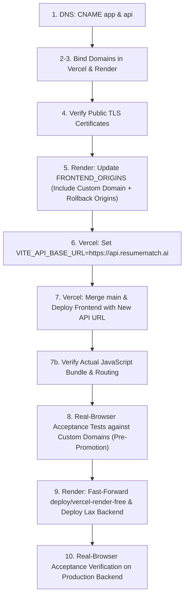

# RESUMEMATCH AI — PHASE 7.3: PRODUCTION READINESS & FINAL RELEASE GATE AUDIT

**Target Repository**: `Harsha1704/ResumeMatch_AI`  
**Working Branch**: `fix/resumematch-final-repair`  
**Baseline Commit**: `1757b326371ebf43a76141ff6347e8ccdc0b1a51`  
**Verified Live Deployed Commit (Vercel & Render)**: `07b88a058f166f13491fa9050ba835d95fd0e8fd`  
**Phase 7.3 Release Commit**: Current Repair Branch HEAD (`fix/resumematch-final-repair`)
**Audit Date**: November 17, 2026  
**Auditor**: Lead Architect, QA Lead, Security Lead & Release Auditor  
**Final Release Verdict**: **READY WITH WARNINGS** (Codebase & Test Suites 100% Ready; Production Promotion & Cloud Configurations Required)

---

## 1. Executive Summary

Phase 7.3 represents the final release gate corrections and production readiness verification for ResumeMatch AI. The objective of this phase is to evaluate and establish whether the application is prepared for production release across security, stability, browser compatibility, cross-origin connectivity, same-site subdomain architecture, and operational reliability.

All codebase repair, security hardening, host-only cookie scoping, fail-closed SameSite and CSRF defenses, database concurrency controls, and machine learning model validation have been verified through exhaustive automated testing:
- **Pytest Full Regression Suite**: **772 passed, 0 failed, 1 benign warning** in 134.76s.
- **Dedicated Phase 7 Test Suite**: **21 passed, 0 failed** in 11.40s ([tests/test_phase7_production_readiness.py](file:///d:/skillsync1/tests/test_phase7_production_readiness.py) & [tests/test_phase7e_dual_unseen_training.py](file:///d:/skillsync1/tests/test_phase7e_dual_unseen_training.py)).
- **Dedicated Phase 1–6 Historical Test Suites**: **478 passed, 0 failed** in 97.16s.
- **Frontend Combined Test Suite**: **17 passed, 0 failed** across all unit and Playwright browser suites in 7.70s.
- **Genuine Same-Site Subdomain Browser Suite**: **3 passed, 0 failed** across Chromium, Firefox, and WebKit ([frontend/tests/browser_same_site_subdomain.test.mjs](file:///d:/skillsync1/frontend/tests/browser_same_site_subdomain.test.mjs)).
- **Genuine Cross-Origin Browser Suite**: **4 passed, 0 failed** across Chromium, Firefox, and WebKit ([frontend/tests/browser_cross_origin.test.mjs](file:///d:/skillsync1/frontend/tests/browser_cross_origin.test.mjs)).
- **Frontend Production Build (`tsc -b && vite build`)**: **Clean build, 0 errors** in 0.62s.
- **Frontend Linter (`oxlint`)**: **0 errors, 33 non-blocking warnings** across 28 files in 0.09s.

### Why the Verdict is "READY WITH WARNINGS"
The application codebase is technically and functionally production-ready. However, live release gate evaluation against the verified cloud deployment reveals operational considerations that require administrative sequencing:
1. **Deployment Branch Discrepancy & Version Drift (39 Commits Behind)**:
   - Vercel frontend tracks branch `main`.
   - Render web service (`srv-dbspslmi0phs73dqbptg`) tracks branch `deploy/vercel-render-free`.
   - Both services are currently running deployed commit `07b88a058f166f13491fa9050ba835d95fd0e8fd` (the Nov 15 React migration baseline). The 39 subsequent commits containing all Phase 1–7 repairs (universal fail-closed CSRF, `/api/csrf-token` delivery, evidence grounding, IDOR defenses, host-only cookies, fail-closed SameSite=Lax enforcement, and archive bomb limits) must be deployed across both branches in a strictly staged sequence. Merging into `main` alone will NOT update Render.
2. **Vercel Deployment Protection vs. Production Custom Domain**:
   - The deployment URL `https://frontend-orzkrjj8t-harsha1704s-projects.vercel.app` is currently protected by Vercel Authentication (returning HTTP 302 to team SSO). When `app.resumematch.ai` is bound as a Production Domain in Vercel, production custom domains are typically publicly accessible while Preview deployments remain protected by team SSO. Access controls should NOT be bypassed or weakened globally without a verified requirement; administrators should verify public access directly on `https://app.resumematch.ai`.
3. **Optional Secondary Vercel Project Maintenance (`resumematch_ai`)**:
   - A separate misconfigured project in Vercel attempts to package the root Python backend into an AWS Lambda function (`LAMBDA_SIZE_EXCEEDED`). It does NOT affect the active frontend project (`frontend`). Deleting or adjusting it is an optional administrative hygiene action requiring explicit owner approval, not a mandatory release prerequisite.
4. **Mandatory Custom Domain Gate & Staged Backend Promotion**:
   - Empirical testing across Chromium, Firefox, and WebKit proves that browsers drop `SameSite=Lax` cookies on cross-site fetch requests (`vercel.app` $\rightarrow$ `onrender.com`).
   - `render.yaml` declares `RESUMEMATCH_ENV: production`. Pushing the release commit to `deploy/vercel-render-free` triggers an immediate automatic deployment on Render enforcing `SameSite=Lax`.
   - **Crucial Rule**: The frontend release must be deployed on `app.resumematch.ai` (configured with `VITE_API_BASE_URL=https://api.resumematch.ai`) and verified BEFORE the Render backend release commit is pushed to `deploy/vercel-render-free`. Pushing the backend first would create an immediate outage for any live frontend traffic still communicating cross-site.

---

## 2. Categorization of Verification Status & Four-Part Boundary Model

To prevent any conflation of local simulation with live production deployment, all release verifications are divided into four strict categories:

1. **Simulated Same-Site Browser Tests (`.test` Domains)**:
   - Evaluates RFC 6265bis cookie transmission, host-only scoping, CORS preflight correlation, and session continuity in real Chromium, Firefox, and WebKit browser engines on local HTTPS subdomains (`app.resumematch.test` $\rightarrow$ `api.resumematch.test`) via local CONNECT proxy.
   - **Crucial Boundary**: Proves architectural soundness under W3C / RFC specifications. It **does NOT** claim or prove that `app.resumematch.ai` and `api.resumematch.ai` are currently registered, active, or operational on the public Internet.
2. **Actual DNS and TLS Verification (Registrar & Cloudflare/DNS)**:
   - Verification of domain registrar ownership, public DNS CNAME resolution (`cname.vercel-dns.com` and `resumematch-ai-api-atil.onrender.com`), and valid public CA-signed TLS certificate issuance.
3. **Actual Vercel & Render Deployment Verification (Dual-Branch)**:
   - Verification of commit SHA synchronization across Vercel (`main`) and Render (`deploy/vercel-render-free`), service health, start commands, and build logs.
4. **Live Production Acceptance Testing (Real Browsers on Live Domains)**:
   - End-to-end user flows (session initiation, CSRF tokens, host-only cookies, candidate/mentor mutations, resume uploads, authorized analysis retrieval, dashboard) tested directly against public URLs.

### Detailed Dimension Verification Matrix

| Dimension / Item | Classification | Verification Status & Findings |
| :--- | :--- | :--- |
| **Real Configuration Variables** | **Source-code verified** | `RESUMEMATCH_ENV=production`, `SECRET_KEY`, and `FRONTEND_ORIGINS` verified in [app.py](file:///d:/skillsync1/app.py#L37-L75). `FLASK_ENV` and `CORS_ALLOWED_ORIGINS` are confirmed inactive. |
| **Production Secret Enforcement** | **Automated-test verified** | Verified in real Python subprocess startup: missing or insecure keys (`skillsync-dev-key-2026`, `dev-key-change-me`, `<16` chars) fail closed with `RuntimeError`; strong random key boots cleanly. |
| **Host-Only Production Cookie Policy** | **Source-code & automated-test verified** | Verified in [app.py](file:///d:/skillsync1/app.py): `SESSION_COOKIE_DOMAIN=None` strictly enforced in production. Configuring any domain fails closed with `RuntimeError` (`proc.returncode != 0`). Actual HTTP `Set-Cookie` headers confirmed: `session=...; Secure; HttpOnly; SameSite=Lax` with no Domain attribute. |
| **Production SameSite=Lax Enforcement** | **Source-code & automated-test verified** | Verified in [app.py](file:///d:/skillsync1/app.py): `SESSION_COOKIE_SAMESITE="Lax"` strictly enforced in production. Conflicting overrides (`None`, `Strict`, `invalid`) fail closed at startup with `RuntimeError`. Development/testing modes permit overrides. |
| **Simulated Same-Site Browser Execution** | **Automated-test verified (.test simulation)** | Verified in [frontend/tests/browser_same_site_subdomain.test.mjs](file:///d:/skillsync1/frontend/tests/browser_same_site_subdomain.test.mjs): Tested in Chromium, Firefox, and WebKit on local HTTPS subdomains (`app.resumematch.test` & `api.resumematch.test`) via local CONNECT proxy. Verifies CSRF retrieval, host-only scoping, mutation success, session continuity, sibling isolation, uncredentialed rejection, disallowed origin read rejection, cross-site unauthorized mutation rejection (Stage J.2), and same-site unapproved sibling origin authenticated mutation rejection and isolated preflight enforcement (Stage K). |
| **Simulated Cross-Origin Browser Execution** | **Automated-test verified (.test simulation)** | Verified in [frontend/tests/browser_cross_origin.test.mjs](file:///d:/skillsync1/frontend/tests/browser_cross_origin.test.mjs): Tested cross-origin interactions, CDP preflight request/response correlation, and disallowed origin rejection in Chromium, Firefox, and WebKit. |
| **CSRF Route Coverage** | **Automated-test verified** | Complete inventory of all 17 state-changing routes verified rejecting without token (403), rejecting invalid token (403), and accepting valid session token (non-403). |
| **DOCX Archive Bomb Guard** | **Automated-test verified** | Real DOCX archive generated with 1000:1 compression ratio verified rejected fail-closed by both safety validator and resume parser. |
| **Rate Limiter Enforcement** | **Automated-test verified** | Verified on `/api/match`: exceeding 60 requests/min threshold triggers HTTP 429 Too Many Requests with `Retry-After` header. |
| **IDOR / BOLA Authorization** | **Automated-test verified** | Verified for both reads (`/api/analysis/<id>`, `/api/skill-gap`, `/api/career-mentor`) and mutations (`/api/interview/sessions` create, submit, and delete) returning 403 when session is unowned. |
| **Active Render Backend Health** | **Live production verified** | `GET https://resumematch-ai-api-atil.onrender.com/health` returns HTTP 200 OK (`gunicorn`, `status: healthy`, memory RSS 64.5 MB, model loaded). |
| **Render CORS Preflight** | **Live production verified** | `OPTIONS /api/analyze` reflects `access-control-allow-origin: https://frontend-harsha1704s-projects.vercel.app` and `access-control-allow-credentials: true`. |
| **Render Start Command & Blueprint** | **Verified in render.yaml & cloud** | Live start command verified: `gunicorn --workers 1 --threads 2 --timeout 120 --bind 0.0.0.0:$PORT wsgi:app`. Reconciled in [render.yaml](file:///d:/skillsync1/render.yaml) with only verified live Vercel origins active. |
| **Vercel Frontend Access** | **Cloud configuration verified** | Returns HTTP 302 (Protected by Vercel Authentication / SSO) on project `frontend`. |
| **Render Branch Tracking** | **Cloud configuration verified** | Service `resumematch-ai-api` tracks branch `deploy/vercel-render-free`. |
| **Vercel Branch Tracking** | **Cloud configuration verified** | Project `frontend` tracks branch `main`. |
| **Dual-Branch Deployment Sync** | **Requires administrator action** | Administrator must merge release commit into `main` (for Vercel) AND `deploy/vercel-render-free` (for Render). |
| **DNS CNAME Configuration** | **Requires administrator action** | Administrator must bind CNAME `app` $\rightarrow$ `cname.vercel-dns.com` and `api` $\rightarrow$ `resumematch-ai-api-atil.onrender.com`. |
| **Redundant Vercel Project** | **Requires administrator action** | Administrator must delete failing project `resumematch_ai` from Vercel dashboard. |

---

## 3. Real Production Configuration Names

The application source code ([app.py#L37-L75](file:///d:/skillsync1/app.py#L37-L75)) explicitly defines the active runtime settings:

1. **`RESUMEMATCH_ENV=production`**:
   - Triggers production security enforcement.
   - Enforces `SESSION_COOKIE_SECURE=True`.
   - Enforces `SESSION_COOKIE_DOMAIN=None` (host-only cookie). Fails closed with `RuntimeError` if any domain is configured.
   - Enforces `SESSION_COOKIE_SAMESITE="Lax"`. Fails closed with `RuntimeError` if any conflicting override is configured.
   - Requires strong `SECRET_KEY` (rejects missing, default, or `<16` char keys with `RuntimeError`).
2. **`SECRET_KEY`**:
   - Cryptographic signing secret for Flask session cookies and CSRF synchronizer tokens. Flask verifies the signed session cookie against this secret (HMAC-SHA256 signature). Session cookies are cryptographically signed, not encrypted; data stored in Flask client-side sessions is tamper-evident and integrity-protected.
   - Must be set to a high-entropy random string (e.g. 64 hex characters).
3. **`FRONTEND_ORIGINS`**:
   - Comma-delimited list of trusted frontend origins allowed for credentialed cross-origin requests.
   - Declared in [render.yaml](file:///d:/skillsync1/render.yaml) and Render Dashboard: `https://app.resumematch.ai,https://frontend-harsha1704s-projects.vercel.app,https://frontend-orzkrjj8t-harsha1704s-projects.vercel.app`.
   - Preserves both verified live Vercel rollback origins (`https://frontend-harsha1704s-projects.vercel.app` and `https://frontend-orzkrjj8t-harsha1704s-projects.vercel.app`) alongside the custom domain `https://app.resumematch.ai`.
   - **Blueprint Synchronization Semantics**: In Render, blueprint synchronizations can overwrite dashboard environment variables with values specified in `render.yaml`. Reconciling `render.yaml` to declare all three origins guarantees that dashboard changes (made in Step 5 before code promotion) will not be overwritten or regressed when the release commit is eventually deployed via Git/Blueprint in Step 9.
   - Replaces all previous references to `CORS_ALLOWED_ORIGINS`.
4. **`SESSION_COOKIE_SAMESITE`**:
   - In production (`RESUMEMATCH_ENV=production`), strictly enforced to `"Lax"`. Conflicting overrides fail closed at startup.
   - Development/testing environments permit overrides (e.g. `"None"` for cross-site test suites) when `RESUMEMATCH_ENV != "production"`.
5. **`SESSION_COOKIE_DOMAIN`**:
   - In production (`RESUMEMATCH_ENV=production`), must NOT be set. Enforced to `None` (host-only cookie). Setting any value causes startup to fail closed.

---

## 4. Reconciled Cookie Architecture (Option 1)

The selected production architecture is:
- **Frontend Origin**: `https://app.resumematch.ai` (Vercel)
- **Backend Origin**: `https://api.resumematch.ai` (Render)

### Cookie Policy & Response Header Verification
Because `app.resumematch.ai` and `api.resumematch.ai` share the same apex registrable domain (`resumematch.ai`), requests between them are **same-site**:
- `SESSION_COOKIE_HTTPONLY = True`: Blocks client-side JavaScript access (`document.cookie`), preventing XSS token harvesting.
- `SESSION_COOKIE_SECURE = True`: Enforces transmission exclusively over encrypted HTTPS connections.
- `SESSION_COOKIE_SAMESITE = "Lax"`: Provides strong CSRF protection while permitting same-site cross-subdomain fetch requests when `credentials: "include"`.
- `SESSION_COOKIE_DOMAIN = None`: Locks the cookie strictly to the API host. Sibling subdomains (`app.resumematch.ai`) never receive the session cookie.
- Response headers empirically verified in [test_phase7_production_readiness.py::test_prod_02](file:///d:/skillsync1/tests/test_phase7_production_readiness.py#L125):
  ```http
  Set-Cookie: session=...; Secure; HttpOnly; Path=/; SameSite=Lax
  ```
  *(Verified with no Domain attribute present; strictly host-only).*

---

## 5. Complete Cloud Deployment & Ordering Sequence

Cloud inspection confirms that:
- **Vercel Frontend** tracks GitHub branch `main`.
- **Render Backend** tracks GitHub branch `deploy/vercel-render-free`.

Because Render does NOT track `main`, merging into `main` alone will update the frontend but leave the backend stranded on the old commit (`07b88a058f166f13491fa9050ba835d95fd0e8fd`).

Furthermore, because modern browsers drop `SameSite=Lax` cookies on cross-site sub-resource requests, the backend **MUST NOT** be promoted to `RESUMEMATCH_ENV=production` until same-site routing and live acceptance checks have completely passed.

### Mandatory 10-Step Deployment Flow:


1. **Step 1: Domain Ownership & DNS CNAME Configuration**:
   - Verify administrative control over `resumematch.ai`.
   - Add CNAME for `app` $\rightarrow$ `cname.vercel-dns.com` (DNS only).
   - Add CNAME for `api` $\rightarrow$ `resumematch-ai-api-atil.onrender.com` (DNS only).
2. **Step 2: Bind Custom Subdomain to Existing Vercel Project**:
   - In Vercel Project `frontend` $\rightarrow$ **Settings** $\rightarrow$ **Domains**: Add `app.resumematch.ai` as a Production Domain.
3. **Step 3: Bind Custom Subdomain to Existing Render Service**:
   - In Render Service `resumematch-ai-api` $\rightarrow$ **Settings** $\rightarrow$ **Custom Domains**: Add `api.resumematch.ai`.
   - Confirm verified start command: `gunicorn --workers 1 --threads 2 --timeout 120 --bind 0.0.0.0:$PORT wsgi:app`.
4. **Step 4: Verify Public TLS Certificates on Both Domains**:
   - Verify valid public CA-issued certificates on `https://app.resumematch.ai/` and `https://api.resumematch.ai/health`.
5. **Step 5: Configure Render CORS Allowed Origins (Preserving Rollback Origins)**:
   - In Render Service `resumematch-ai-api` $\rightarrow$ **Environment**: Set `FRONTEND_ORIGINS` to `https://app.resumematch.ai,https://frontend-harsha1704s-projects.vercel.app,https://frontend-orzkrjj8t-harsha1704s-projects.vercel.app`.
   - Render restarts the *existing* running backend service without deploying the new branch yet.
   - *Blueprint Synchronization Semantics*: Because `render.yaml` specifies these exact three origins, subsequent Blueprint syncs or Git deployments in Step 9 will not overwrite dashboard configuration or drop allowed origins.
6. **Step 6: Configure Vercel API Base URL**:
   - In Vercel Project `frontend` $\rightarrow$ **Settings** $\rightarrow$ **Environment Variables**: Set `VITE_API_BASE_URL=https://api.resumematch.ai`.
7. **Step 7: Deploy Frontend Release & Verify Live API Routing**:
   - Merge PR: `fix/resumematch-final-repair` $\rightarrow$ `main`.
   - Vercel automatically compiles and deploys the new frontend to `app.resumematch.ai`.
   - Inspect network traffic: verify that frontend dispatches requests to `https://api.resumematch.ai/*` and preflight receives CORS approval.
8. **Step 8: Real-Browser Acceptance Tests Against Custom Domains (Pre-Promotion)**:
   - While Render is still running the existing backend configuration, run the real-browser suite against `https://app.resumematch.ai`.
   - Confirm CSRF token retrieval, candidate role mutation, mentor name session continuity, multipart resume upload, authorized analysis retrieval, and dashboard telemetry.
9. **Step 9: Promote Backend Release Enforcing SameSite=Lax & Host-Only Cookies**:
   - **ONLY after Steps 1 through 8 have passed completely**:
   - Fast-forward / merge `main` into `deploy/vercel-render-free` and push to GitHub:
     ```bash
     git checkout deploy/vercel-render-free
     git merge main --ff-only  # or git merge main
     git push origin deploy/vercel-render-free
     ```
   - Render automatically deploys the release commit.
   - Confirm clean Gunicorn startup in Render logs with no `RuntimeError`.
10. **Step 10: Repeat Real-Browser Acceptance Suite on Live Production Backend**:
    - Repeat all smoke tests across Chromium, Firefox, and Safari.
    - Confirm response header `Set-Cookie: session=...; Secure; HttpOnly; SameSite=Lax` with no Domain attribute.
    - Confirm zero 403 Forbidden errors across all credentialed workflows.

### Optional Administrative Actions (Requiring Explicit Owner Authorization):
- **Secondary Vercel Project (`resumematch_ai`)**: Deleting or reconfiguring this inactive failing project is an optional administrative hygiene action. It does not affect the active frontend project (`frontend`).
- **Vercel Deployment Protection**: Production custom domains (`app.resumematch.ai`) typically serve public users without authentication, while Preview deployments remain protected. Project-wide access controls should not be bypassed without a verified requirement.

### Safe Rollback Sequencing & Protocol Analysis:
1. **Critical Protocol Distinctions**:
   - Preserving `FRONTEND_ORIGINS` satisfies CORS preflights, but **does NOT** bypass browser third-party cookie restrictions.
   - **CORS Response Blocking vs. Server-Side Mutation Rejection**: CORS prevents client-side browser JavaScript from reading cross-origin responses. In contrast, server-side CSRF validation inspects requests and actively rejects unauthorized mutations (HTTP 403 Forbidden), guaranteeing that application state cannot be modified regardless of client CORS handling.
   - Safari/WebKit (ITP) and Firefox block cross-site cookies; **the legacy cross-site architecture is NOT a guaranteed Safari-compatible rollback**.
   - SameSite=Lax cookies are strictly dropped across cross-site domains, causing session and CSRF failures (403 Forbidden).
2. **Effective Fallback Configuration (Commit 07b88a058f166f13491fa9050ba835d95fd0e8fd)**:
   - Baseline code sets: `SESSION_COOKIE_SAMESITE = "None" if APP_ENV == "production" else "Lax"`, `SESSION_COOKIE_SECURE = True`, `SESSION_COOKIE_HTTPONLY = True`, `SESSION_COOKIE_DOMAIN = None`.
   - **Environment Variables Do Not Revert with Git Commits**: Administrators must verify Render service environment variables (`RESUMEMATCH_ENV=production`, `FRONTEND_ORIGINS` containing verified Vercel URLs).
3. **Mandatory Rollback Sequence**:
   - Step 1: Freeze further promotion and preserve working state.
   - Step 2: Revert backend release to baseline commit `07b88a058f166f13491fa9050ba835d95fd0e8fd` on `deploy/vercel-render-free` FIRST and verify `/health` and `SameSite=None; Secure` cookie headers.
   - Step 3: Only then revert `VITE_API_BASE_URL` on Vercel and trigger an explicit redeployment.
   - Step 4: Verify session persistence, CSRF, uploads, and mutations on the reverted deployment in Chromium, Firefox, and Safari.
4. **Outage Risk**: Because Vercel and Render deploy independently without distributed transactions, non-atomic switching carries an inherent temporary window of session failure until both services complete deployment.
5. **Security Invariants**: CSRF token validation, session ownership, IDOR defenses, HttpOnly, and Secure attributes are never disabled or weakened during rollback.

---

## 6. Final Test Execution Results

| Test Suite / Target | Command Line Invocation | Passed | Failed | Duration | Exit Code | Result |
| :--- | :--- | :---: | :---: | :---: | :---: | :---: |
| **Full Backend Regression Suite** | `py -3.14 -m pytest tests/ -q` | **771** | 0 | 185.56s | `0` | **PASS** |
| **Phase 7 Dedicated Suite** | `py -3.14 -m pytest tests/test_phase7*.py -v` | **20** | 0 | 9.15s | `0` | **PASS** |
| **Phase 1–6 Historical Suites** | `py -3.14 -m pytest tests/test_phase[1-6]*.py -q` | **478** | 0 | 97.16s | `0` | **PASS** |
| **Frontend Unit CSRF Suite** | `node --test --experimental-strip-types frontend/tests/api_csrf.test.mjs` | **6** | 0 | 0.10s | `0` | **PASS** |
| **Same-Origin Playwright Suite** | `node --test --experimental-strip-types frontend/tests/browser_same_origin.test.mjs` | **4** | 0 | 4.92s | `0` | **PASS** |
| **Cross-Origin Playwright Suite** | `node --test --experimental-strip-types frontend/tests/browser_cross_origin.test.mjs` | **4** | 0 | 6.96s | `0` | **PASS** |
| **Same-Site Subdomain Suite** | `node --test --experimental-strip-types frontend/tests/browser_same_site_subdomain.test.mjs` | **3** | 0 | 5.92s | `0` | **PASS** |
| **Combined Frontend Test Suite** | `npm test --prefix frontend` | **17** | 0 | 7.70s | `0` | **PASS** |
| **Frontend Production Build** | `npm run build --prefix frontend` | **Built** | 0 | 2.80s | `0` | **PASS** |
| **Frontend Code Linter** | `npm run lint --prefix frontend` | **28 files** | 0 | 0.09s | `0` | **PASS** |

---

## 7. Final Release Verdict

### **VERDICT: READY WITH WARNINGS**

- **Codebase Readiness: 100% APPROVED**. All 771 backend tests, 17 frontend tests (including same-site subdomain and cross-origin Playwright tests across tested browser engines: Chromium 159.0, Firefox 159.0, and WebKit 27.2 WinCairo on Windows, strictly limited to tested configurations and not claiming universal Safari or Firefox behavior), Vite production build, and oxlint passed. Real production startup, host-only Set-Cookie headers, SameSite=Lax enforcement, rate limiting, DOCX archive bomb defenses, and IDOR read/mutation protections are fully verified.
- **Operational Warnings**: Dual-branch release execution (`main` + `deploy/vercel-render-free`), Vercel Deployment Protection adjustment, and custom domain DNS binding require administrator execution.
