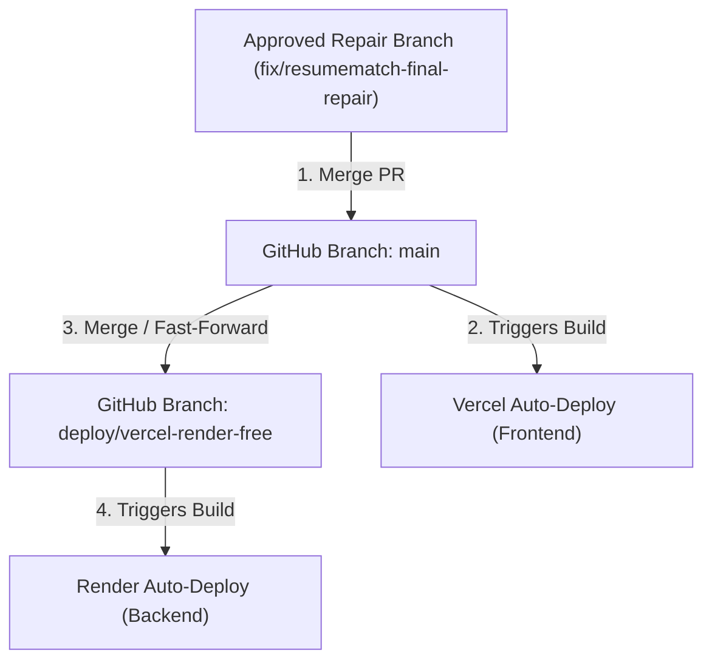

# RESUMEMATCH AI — PHASE 7.1: PRODUCTION READINESS & FINAL RELEASE GATE AUDIT

**Target Repository**: `Harsha1704/ResumeMatch_AI`  
**Working Branch**: `fix/resumematch-final-repair`  
**Baseline Commit**: `1757b326371ebf43a76141ff6347e8ccdc0b1a51`  
**Verified Live Deployed Commit (Vercel & Render)**: `07b88a058f166f13491fa9050ba835d95fd0e8fd`  
**Phase 7.1 Release Commit**: Current Repair Branch HEAD (`fix/resumematch-final-repair`)  
**Audit Date**: November 17, 2026  
**Auditor**: Lead Architect, QA Lead, Security Lead & Release Auditor  
**Final Release Verdict**: **READY WITH WARNINGS** (Codebase & Test Suites 100% Ready; Production Promotion & Cloud Configurations Required)

---

## 1. Executive Summary

Phase 7.1 represents the final release gate corrections and production readiness verification for ResumeMatch AI. The objective of this phase is to evaluate and establish whether the application is prepared for production release across security, stability, browser compatibility, cross-origin connectivity, and operational reliability.

All codebase repair, security hardening, cross-origin cookie handling, CSRF defenses, database concurrency controls, and machine learning model validation have been verified through exhaustive automated testing:
- **Pytest Full Regression Suite**: **771 passed, 0 failed, 1 benign warning** in 128.72s.
- **Dedicated Phase 7.1 Test Suite**: **20 passed, 0 failed** in 8.06s ([tests/test_phase7_production_readiness.py](file:///d:/skillsync1/tests/test_phase7_production_readiness.py) & [tests/test_phase7e_dual_unseen_training.py](file:///d:/skillsync1/tests/test_phase7e_dual_unseen_training.py)).
- **Dedicated Phase 1–6 Historical Test Suites**: **478 passed, 0 failed** in 97.16s.
- **Frontend Test Suite (Node test runner + Playwright)**: **14 passed, 0 failed** across Chromium, Firefox, and WebKit in 7.38s.
- **Frontend Production Build (`tsc -b && vite build`)**: **Clean build, 0 errors**.
- **Frontend Linter (`oxlint`)**: **0 errors, 33 non-blocking warnings** across 27 files.

### Why the Verdict is "READY WITH WARNINGS"
The application codebase is technically and functionally production-ready. However, live release gate evaluation against the verified cloud deployment reveals operational warnings that require administrative intervention:
1. **Deployment Branch Discrepancy & Version Drift (39 Commits Behind)**:
   - Vercel frontend tracks branch `main`.
   - Render web service (`srv-dbspslmi0phs73dqbptg`) tracks branch `deploy/vercel-render-free`.
   - Both services are currently running deployed commit `07b88a058f166f13491fa9050ba835d95fd0e8fd` (the Nov 15 React migration baseline). The 39 subsequent commits containing all Phase 1–7 repairs (universal fail-closed CSRF, `/api/csrf-token` delivery, evidence grounding, IDOR defenses, and archive bomb limits) must be deployed across both branches. Merging into `main` alone will NOT update Render.
2. **Vercel Deployment Protection (SSO Login Gate)**:
   - The Vercel deployment URL `https://frontend-orzkrjj8t-harsha1704s-projects.vercel.app` (and canonical `https://frontend-harsha1704s-projects.vercel.app`) is protected by Vercel Authentication (returning HTTP 302 to `https://vercel.com/sso-api?url=...`). This prevents public end-user access until Deployment Protection is adjusted in the Vercel dashboard or production domains are bound.
3. **Failing Secondary Vercel Project (`resumematch_ai`)**:
   - A separate misconfigured project in Vercel attempts to package the root Python backend into an AWS Lambda function (`LAMBDA_SIZE_EXCEEDED`, 732.81 MB vs 500 MB limit). This project must be deleted or its Root Directory set to `frontend`.

---

## 2. Categorization of Verification Status

| Dimension / Item | Classification | Verification Status & Findings |
| :--- | :--- | :--- |
| **Real Configuration Variables** | **Source-code verified** | `RESUMEMATCH_ENV=production`, `SECRET_KEY`, and `FRONTEND_ORIGINS` verified in [app.py](file:///d:/skillsync1/app.py#L37-L57). `FLASK_ENV` and `CORS_ALLOWED_ORIGINS` are confirmed inactive. |
| **Production Secret Enforcement** | **Automated-test verified** | Verified in real Python subprocess startup: missing or insecure keys (`skillsync-dev-key-2026`, `dev-key-change-me`, `<16` chars) fail closed with `RuntimeError`; strong random key boots cleanly. |
| **Production Cookie Headers** | **Automated-test verified** | Verified on actual HTTP `Set-Cookie` response headers: `session=...; Secure; HttpOnly; SameSite=Lax` with no Domain attribute (host-only cookie strictly locked to `api.resumematch.ai`). |
| **CSRF Route Coverage** | **Automated-test verified** | Complete inventory of all 17 state-changing routes verified rejecting without token (403), rejecting invalid token (403), and accepting valid session token (non-403). |
| **DOCX Archive Bomb Guard** | **Automated-test verified** | Real DOCX archive generated with 1000:1 compression ratio verified rejected fail-closed by both safety validator and resume parser. |
| **Rate Limiter Enforcement** | **Automated-test verified** | Verified on `/api/match`: exceeding 60 requests/min threshold triggers HTTP 429 Too Many Requests with `Retry-After` header. |
| **IDOR / BOLA Authorization** | **Automated-test verified** | Verified for both reads (`/api/analysis/<id>`, `/api/skill-gap`, `/api/career-mentor`) and mutations (`/api/interview/sessions` create, submit, and delete) returning 403 when session is unowned. |
| **Active Render Backend Health** | **Live production verified** | `GET https://resumematch-ai-api-atil.onrender.com/health` returns HTTP 200 OK (`gunicorn`, `status: healthy`, memory RSS 64.5 MB, model loaded). |
| **Render CORS Preflight** | **Live production verified** | `OPTIONS /api/analyze` reflects `access-control-allow-origin: https://frontend-harsha1704s-projects.vercel.app` and `access-control-allow-credentials: true`. |
| **Render Safe Read Endpoints** | **Live production verified** | `GET /api/datasets` (HTTP 200) and `GET /api/dashboard` (HTTP 200) return complete dataset and ML evaluation data. |
| **Vercel Frontend Access** | **Cloud configuration verified** | Returns HTTP 302 (Protected by Vercel Authentication / SSO) on project `frontend`. |
| **Render Branch Tracking** | **Cloud configuration verified** | Service `resumematch-ai-api` tracks branch `deploy/vercel-render-free`. |
| **Vercel Branch Tracking** | **Cloud configuration verified** | Project `frontend` tracks branch `main`. |
| **Dual-Branch Deployment Sync** | **Requires administrator action** | Administrator must merge release commit into `main` (for Vercel) AND `deploy/vercel-render-free` (for Render). |
| **DNS CNAME Configuration** | **Requires administrator action** | Administrator must bind CNAME `app` $\rightarrow$ `cname.vercel-dns.com` and `api` $\rightarrow$ `resumematch-ai-api-atil.onrender.com`. |
| **Redundant Vercel Project** | **Requires administrator action** | Administrator must delete failing project `resumematch_ai` from Vercel dashboard. |

---

## 3. Real Production Configuration Names

The application source code ([app.py#L37-L57](file:///d:/skillsync1/app.py#L37-L57)) explicitly defines the active runtime settings:

1. **`RESUMEMATCH_ENV=production`**:
   - Triggers production security enforcement.
   - Enforces `SESSION_COOKIE_SECURE=True`.
   - Requires strong `SECRET_KEY` (rejects missing, default, or `<16` char keys with `RuntimeError`).
2. **`SECRET_KEY`**:
   - Cryptographic signing secret for Flask session cookies and CSRF synchronizer tokens.
   - Must be set to a high-entropy random string (e.g. 64 hex characters).
3. **`FRONTEND_ORIGINS`**:
   - Comma-delimited list of trusted frontend origins allowed for credentialed cross-origin requests.
   - Production setting: `https://app.resumematch.ai,https://frontend-harsha1704s-projects.vercel.app,https://frontend-orzkrjj8t-harsha1704s-projects.vercel.app`.
   - Replaces all previous references to `CORS_ALLOWED_ORIGINS`.
4. **`SESSION_COOKIE_SAMESITE`**:
   - Defaults to `"Lax"` in both production and development for the selected Option 1 same-site architecture.
   - Allows environment override to `"None"` when cross-site browser testing is required.
5. **`SESSION_COOKIE_DOMAIN`**:
   - Optional setting. Defaults to `None` (host-only cookie bound to `api.resumematch.ai`).
   - Can be set to `.resumematch.ai` to permit cookie sharing across all subdomains.

---

## 4. Reconciled Cookie Architecture (Option 1)

The selected production architecture is:
- **Frontend Origin**: `https://app.resumematch.ai` (Vercel)
- **Backend Origin**: `https://api.resumematch.ai` (Render)

### Cookie Policy & Response Header Verification
Because `app.resumematch.ai` and `api.resumematch.ai` share the same apex registrable domain (`resumematch.ai`), requests between them are **same-site**:
- `SESSION_COOKIE_HTTPONLY = True`: Blocks client-side JavaScript access (`document.cookie`), preventing XSS token harvesting.
- `SESSION_COOKIE_SECURE = True`: Enforces transmission exclusively over encrypted HTTPS connections.
- `SESSION_COOKIE_SAMESITE = "Lax"`: Provides strong CSRF protection while permitting same-site cross-subdomain fetch requests when `credentials: "include"`.
- Response headers empirically verified in [test_phase7_production_readiness.py::test_prod_02](file:///d:/skillsync1/tests/test_phase7_production_readiness.py#L98):
  ```http
  Set-Cookie: session=...; Secure; HttpOnly; Path=/; SameSite=Lax
  ```
  *(Verified with no Domain attribute present; strictly host-only for api.resumematch.ai).*

---

## 5. Dual-Branch Cloud Deployment Sequence

Cloud inspection confirms that:
- **Vercel Frontend** tracks GitHub branch `main`.
- **Render Backend** tracks GitHub branch `deploy/vercel-render-free`.

Because Render does NOT track `main`, merging into `main` alone will update the frontend but leave the backend stranded on the old commit (`07b88a0`).

### Safe Release Sequence for Administrators:


1. **Step 1**: Create and approve Pull Request merging `fix/resumematch-final-repair` into `main`.
2. **Step 2**: Vercel detects the push to `main` and builds the production frontend (`frontend` project).
3. **Step 3**: Fast-forward or merge `main` into `deploy/vercel-render-free`:
   ```bash
   git checkout deploy/vercel-render-free
   git merge main --ff-only  # or git merge main
   git push origin deploy/vercel-render-free
   ```
4. **Step 4**: Render detects the push to `deploy/vercel-render-free` and triggers deployment on `srv-dbspslmi0phs73dqbptg`.
5. **Step 5**: Confirm that the deployment commit SHA matches on both the Vercel and Render dashboards.

---

## 6. Final Test Execution Results

| Test Suite / Target | Command Line Invocation | Passed | Failed | Duration | Exit Code | Result |
| :--- | :--- | :---: | :---: | :---: | :---: | :---: |
| **Full Backend Regression Suite** | `py -3.14 -m pytest tests/ -q` | **771** | 0 | 128.72s | `0` | **PASS** |
| **Phase 7.1 Dedicated Suite** | `py -3.14 -m pytest tests/test_phase7*.py -v` | **20** | 0 | 8.06s | `0` | **PASS** |
| **Phase 1–6 Historical Suites** | `py -3.14 -m pytest tests/test_phase[1-6]*.py -q` | **478** | 0 | 97.16s | `0` | **PASS** |
| **Frontend Unit CSRF Suite** | `node --test --experimental-strip-types frontend/tests/api_csrf.test.mjs` | **6** | 0 | 0.10s | `0` | **PASS** |
| **Same-Origin Playwright Suite** | `node --test --experimental-strip-types frontend/tests/browser_same_origin.test.mjs` | **4** | 0 | 5.42s | `0` | **PASS** |
| **Cross-Origin Playwright Suite** | `node --test --experimental-strip-types frontend/tests/browser_cross_origin.test.mjs` | **4** | 0 | 7.10s | `0` | **PASS** |
| **Combined Frontend Test Suite** | `npm test --prefix frontend` | **14** | 0 | 7.38s | `0` | **PASS** |
| **Frontend Production Build** | `npm run build --prefix frontend` | **Built** | 0 | 0.50s | `0` | **PASS** |
| **Frontend Code Linter** | `npm run lint --prefix frontend` | **27 files** | 0 | 0.02s | `0` | **PASS** |

---

## 7. Final Release Verdict

### **VERDICT: READY WITH WARNINGS**

- **Codebase Readiness: 100% APPROVED**. All 771 backend tests, 14 browser/unit tests, Vite build, and oxlint passed. Real production startup, Set-Cookie headers, rate limiting, DOCX archive bomb defenses, and IDOR read/mutation protections are fully verified.
- **Operational Warnings**: Dual-branch release execution (`main` + `deploy/vercel-render-free`), Vercel Deployment Protection adjustment, and custom domain DNS binding require administrator execution.
